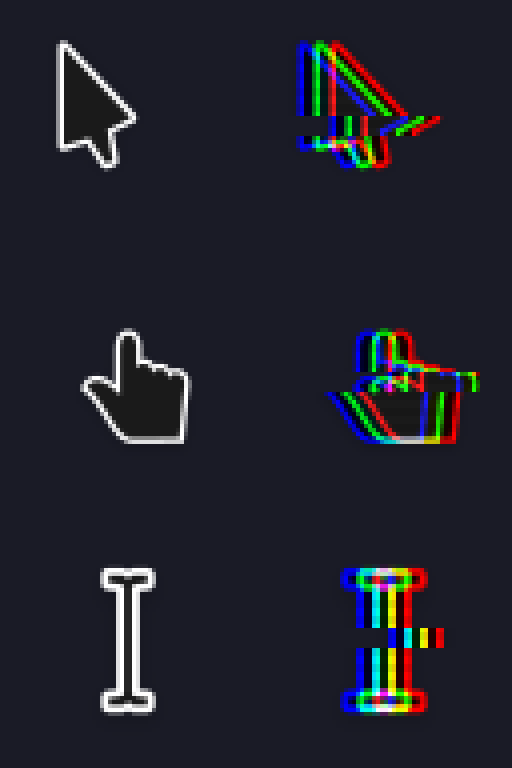
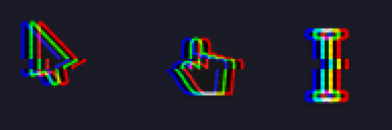
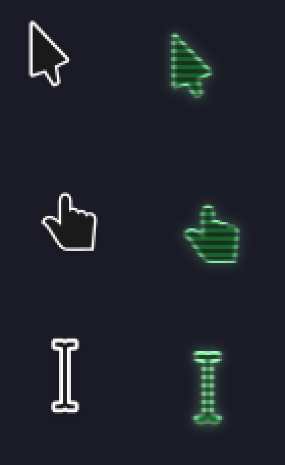
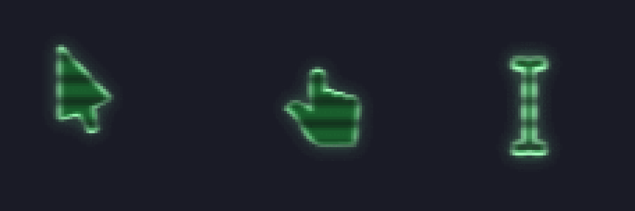
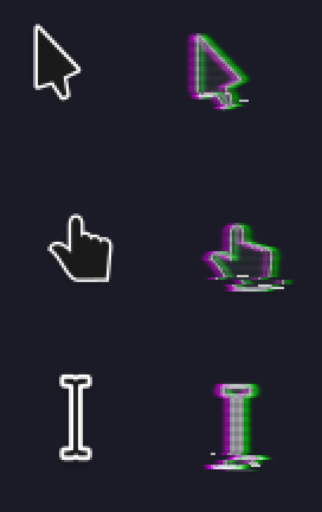
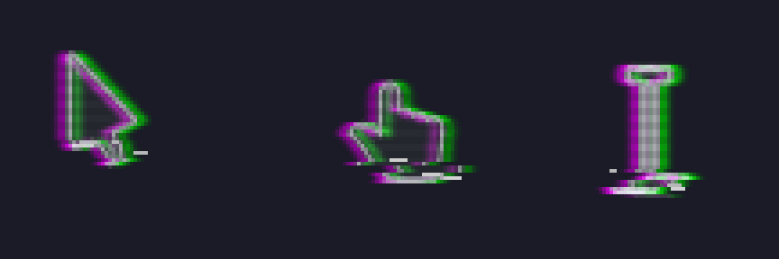

# xcursor-forge

Turn the Linux cursor theme you already like into a styled variant: glitchy
RGB split, CRT phosphor monitor or worn VHS tape, each static or animated.

xcursor-forge reads an existing Xcursor theme, applies a style to every cursor
(all sizes, hotspots and animations preserved) and writes a new, ready to use
theme. It works on any desktop that uses Xcursor themes: niri, Hyprland, Sway,
GNOME, KDE, X11…

| `glitch` | `glitch-anim` | `crt` | `crt-anim` | `vhs` | `vhs-anim` |
|---|---|---|---|---|---|
|  |  |  |  |  |  |

*Previews made from [Capitaine Cursors](https://github.com/keeferrourke/capitaine-cursors).*

> 🇧🇷 [Leia em português](#português)

## Styles

| Style | Description |
|---|---|
| `glitch` | Static RGB split (red/blue channels pulled apart), a torn horizontal band and scanlines. |
| `glitch-anim` | The glitch at rest for 1.2 s, then a ~0.35 s burst of heavier, random glitches. Each cursor gets its own burst. Cursors that were already animated (e.g. `wait`) keep their timing. |
| `crt` | Monochrome phosphor monitor: tinted image, scanlines, beam smear and bloom. Green by default; try `--color ffb000` for amber. |
| `crt-anim` | The CRT with wider, soft scanlines rolling down the cursor, like a TV filmed by a camera. |
| `vhs` | Worn tape: soft magenta/green color fringes, washed out tones, faint scanlines and a tracking band of torn rows and white dropouts near the bottom of the cursor. |
| `vhs-anim` | The tape at rest for a couple of seconds, then the tracking band travels up the cursor while the picture wobbles sideways. Each cursor has its own noise and beat. |

## Download prebuilt themes

Ready to use themes built from Capitaine Cursors are attached to the
[releases](https://github.com/RodrigoRosa7/xcursor-forge/releases/latest), one
`.tar.xz` per style. Extract one into your icons folder and select it:

```sh
tar -xf capitaine-cursors-vhs-anim.tar.xz -C ~/.local/share/icons
```

They are LGPL-3.0, like Capitaine Cursors; the license and credits are inside
each archive.

## Requirements

- Python 3.10+
- [NumPy](https://numpy.org/) (`sudo pacman -S python-numpy`, `sudo apt install python3-numpy`, …)
- ImageMagick only if you want to regenerate the README previews

## Usage

Run it straight from a clone, no install needed:

```sh
git clone https://github.com/RodrigoRosa7/xcursor-forge
cd xcursor-forge
python3 -m xcursor_forge styles

# preview one cursor (original + styled frames) before building
python3 -m xcursor_forge preview Adwaita -s glitch -c default -o preview.png

# build into ./dist
python3 -m xcursor_forge build Adwaita -s glitch-anim

# pick the phosphor color (crt, crt-anim), e.g. amber
python3 -m xcursor_forge build Adwaita -s crt --color ffb000 -n Adwaita-crt-amber

# or build straight into ~/.local/share/icons
python3 -m xcursor_forge build capitaine-cursors -s glitch-anim --install
```

Or install the `xcursor-forge` command with `pipx install .` (from the clone).

The base theme can be a name found in `~/.local/share/icons`, `~/.icons`,
`/usr/local/share/icons` or `/usr/share/icons`, or a path to a theme directory.

| Option | |
|---|---|
| `-s, --style` | style to apply (see `styles`) |
| `-n, --name` | output theme name (default `<base>-<style>`) |
| `-o, --out` | output directory (default `./dist`) |
| `-i, --install` | write into `~/.local/share/icons` |
| `--intensity` | effect strength multiplier, e.g. `0.75` or `1.5` (default `1.0`) |
| `--color` | effect color as hex, for styles that have one (`crt`, `crt-anim`) |
| `-f, --force` | replace an existing output theme |

### Applying the theme

- **niri**: `cursor { xcursor-theme "capitaine-cursors-glitch-anim"; xcursor-size 32; }` in your config.
- **GTK apps**: `gsettings set org.gnome.desktop.interface cursor-theme 'capitaine-cursors-glitch-anim'`
- **Noctalia**: the [Cursor plugin](https://noctalia.dev/plugins/community/cursor) can install and apply a built theme folder for you, and revert it later.
- Already running apps keep the old cursor until restarted.

The effect is drawn in proportion to the cursor size. At 24 px it is subtle;
32 px or more shows the colors better. The crt and vhs styles add a transparent
margin around each cursor for the glow and noise; the hotspot moves with it, so the
click point is unchanged.

Animated styles store every frame of every size, so the built theme is larger
on disk (roughly 80 MB from Capitaine Cursors, against 20 to 30 MB for the
static styles).

## License

The **code** is MIT licensed (see [LICENSE](LICENSE)).

**Generated themes are derived works of the base theme's artwork** and are
covered by the base theme's license, not by MIT. For example, a theme built
from Capitaine Cursors is LGPL-3.0. Each generated theme contains a
`GENERATED.txt` noting its base. If you redistribute a generated theme, keep
the base theme's license and credits with it.

## Adding a style

Styles live in [`xcursor_forge/styles.py`](xcursor_forge/styles.py). A style is
a function that receives the frames of one cursor (straight RGBA arrays, with
size, hotspot and delay), the intensity and an optional color, and returns new
frames; register it in `STYLES`.
Run the tests with `python3 -m unittest discover -s tests`.

---

## Português

O xcursor-forge pega um tema de cursor que você já tem no Linux e gera uma
versão estilizada dele: glitch (separação RGB), CRT (monitor de fósforo) ou
VHS (fita gasta), cada um em versão estática e animada. Os estilos crt aceitam `--color`. Todos os tamanhos, hotspots e animações do tema
original são mantidos.

**Uso rápido:**

```sh
git clone https://github.com/RodrigoRosa7/xcursor-forge
cd xcursor-forge
python3 -m xcursor_forge build capitaine-cursors -s glitch-anim --install
```

Depois escolha o tema `capitaine-cursors-glitch-anim` no seu ambiente (no niri:
`xcursor-theme` dentro do bloco `cursor`; nos apps GTK: `gsettings`). O plugin
[Cursor do Noctalia](https://noctalia.dev/plugins/community/cursor) também
instala e aplica o tema, e permite reverter pela interface.

**Temas prontos:** na página de
[releases](https://github.com/RodrigoRosa7/xcursor-forge/releases/latest) há um
`.tar.xz` por estilo, feito a partir do Capitaine Cursors. Extraia em
`~/.local/share/icons` e selecione o tema.

**Licença:** o código é MIT. Os temas gerados são derivados do tema base e
seguem a licença dele (ex.: Capitaine Cursors → LGPL-3.0).
